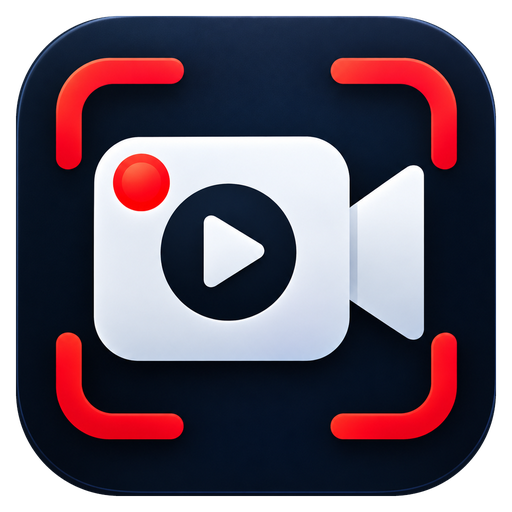

<p align="center"></p>

# RecFlow

Gravador de tela com editor de vídeo para Windows, feito com Electron (HTML, CSS e JavaScript).

## Recursos

- **Modos de gravação:** tela inteira (escolha do monitor), área retangular em qualquer monitor, janela específica e somente webcam
- **Áudio:** som do sistema e microfone mixados, com volume ajustável (também durante a gravação), gráfico do sinal em tempo real e teste de 5 segundos (grava e toca)
- **Editor após a gravação:** reproduzir quadro a quadro, linha do tempo com miniaturas e forma de onda, cortar início/fim e remover trechos, zoom animado em uma área, textos, desenhos, desfazer/refazer
- **Exportar** em MP4 (3 qualidades), **WhatsApp/e-mail** (até 720p, ~15 MB) ou **GIF animado**
- **Projetos (.gtproj):** salve a edição e continue depois; com o app instalado, abre com duplo clique
- **Contagem regressiva** (3, 5 ou 10 s) antes de gravar
- **Teclas pressionadas no vídeo** (posição, tamanho, tempo e modo "só atalhos")
- **Fundo desfocado na webcam** (IA local, sem tela verde)
- **Redução de ruído forte** no microfone (RNNoise, IA local)
- **Logo / marca d'água** opcional em todas as gravações
- **Webcam junto com a tela:** janela flutuante que você arrasta e redimensiona a qualquer momento (inclusive gravando), em círculo ou retângulo, com espelhamento e posicionamento rápido. Atalho Ctrl+Shift+W mostra/oculta
- **Desenho na tela:** caneta, marca-texto, linha, seta, retângulo, elipse, borracha, cores, espessuras, desfazer e limpar. A barra de ferramentas não aparece no vídeo
- **Efeitos de clique:** círculo amarelo (esquerdo), vermelho (direito) e verde (meio)
- **Atalhos globais configuráveis:** F12 grava/para, Shift+F12 pausa, F11 captura imagem, Ctrl+Shift+D desenho, Ctrl+Shift+X limpa
- **Gravação agendada:** data/hora de início e duração
- **Captura de imagem (PNG)**, pausa/retomada, bandeja do sistema, lista de arquivos
- Saída em **MP4 (H.264/AAC)** ou **WebM (VP9/Opus)**, de 15 a 60 fps e 4 níveis de qualidade
- A janela do gravador pode ficar oculta no vídeo (Windows 10 2004 ou mais recente)
- Tema claro, escuro ou igual ao Windows, com a cor de destaque do sistema e barra de rolagem fina

## Como rodar

Requisitos: [Node.js](https://nodejs.org) 20 ou mais recente.

```bash
npm install
npm start
```

## Gerar instalador (.exe)

```bash
npm run dist
```

O instalador fica na pasta `dist/`.

## Estrutura

```
main.js          Processo principal: janelas, captura, gravação em disco, atalhos, bandeja, agendamento
preload.js       Ponte segura (contextBridge) entre a interface e o processo principal
src/index.html   Interface principal
src/renderer.js  Motor de gravação (MediaRecorder + canvas + Web Audio) e lógica da interface
src/styles.css   Tema escuro
src/selector.*   Seleção de área
src/overlay.*    Camada de desenho e efeitos de clique (aparece no vídeo)
src/toolbar.*    Barra de ferramentas de desenho (não aparece no vídeo)
src/border.html  Borda vermelha da área gravada
src/cam.*        Janela flutuante da webcam
src/editor.*     Editor de vídeo (a exportação usa o FFmpeg do pacote ffmpeg-static)
src/blur.js      Desfoque do fundo da webcam (MediaPipe)
src/countdown.*  Contagem regressiva
assets/selfie_segmenter.tflite  Modelo de IA que separa a pessoa do fundo
```

As configurações ficam em `%APPDATA%\RecFlow\settings.json` (as da versão anterior, "Gravador de Tela", são copiadas automaticamente). Os vídeos novos vão para `Vídeos\RecFlow` (dá para trocar na aba Vídeo).

## Observações

- Depois de atualizar o projeto, rode `npm install` de novo (FFmpeg, MediaPipe e RNNoise vêm como pacotes).
- O duplo clique em arquivos `.gtproj` funciona com o app instalado pelo `npm run dist`. Rodando com `npm start`, use "Abrir projeto…".

- Os efeitos de clique usam o módulo nativo opcional `uiohook-napi`. Se ele não instalar, o resto funciona normalmente.
- Desenho e efeitos de clique aparecem nos modos **Tela inteira** e **Área**. No modo **Janela**, apenas o conteúdo da própria janela é gravado.
- A gravação agendada só dispara com o programa aberto (pode estar minimizado na bandeja).
- Arquivos WebM gravados pelo navegador não trazem a duração no cabeçalho; alguns players demoram para permitir avançar. O MP4 (padrão) não tem esse problema.

## Sobre

- **Desenvolvedor:** Hendell A. Cardoso
- **E-mail:** suporte@api2dev.com.br
- **WhatsApp:** (62) 9.9314-8955
- **Website:** https://api2dev.com.br
